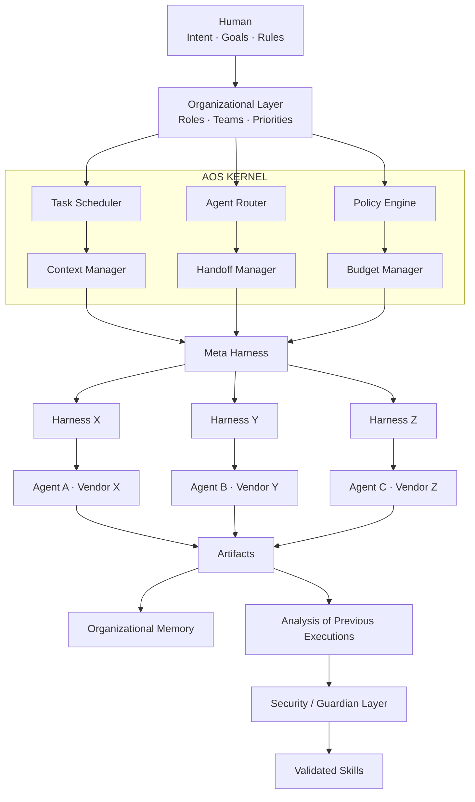
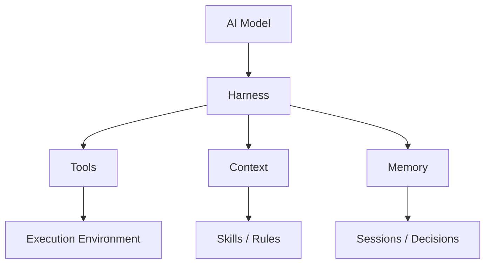
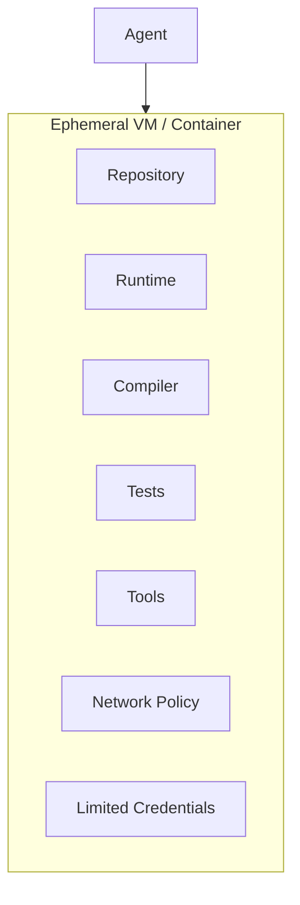
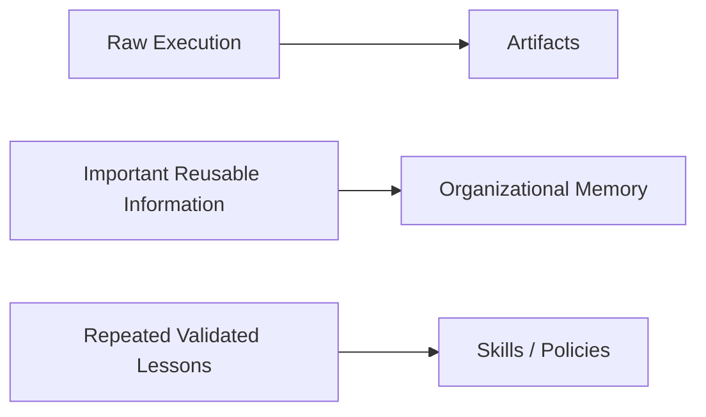
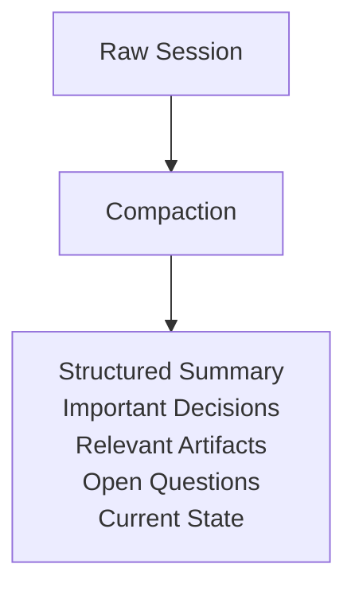
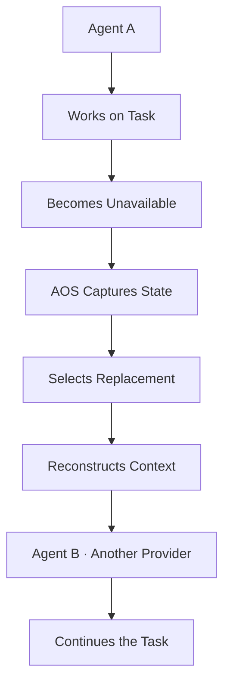
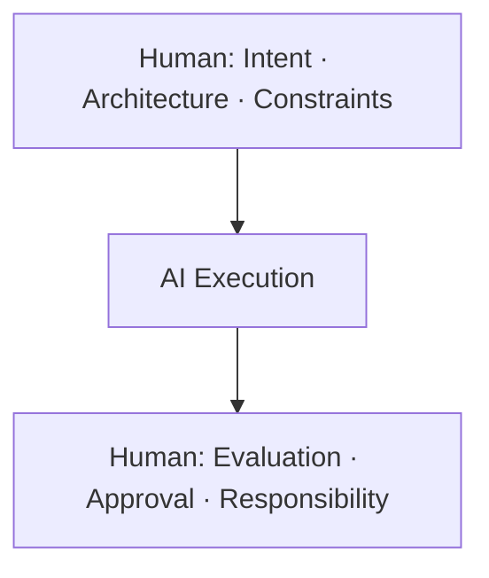
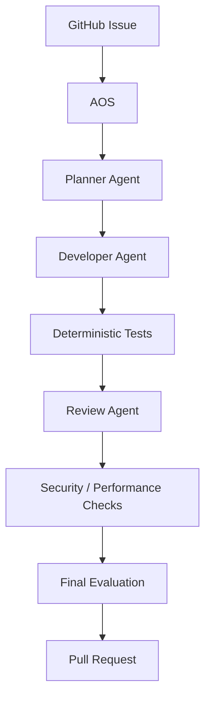
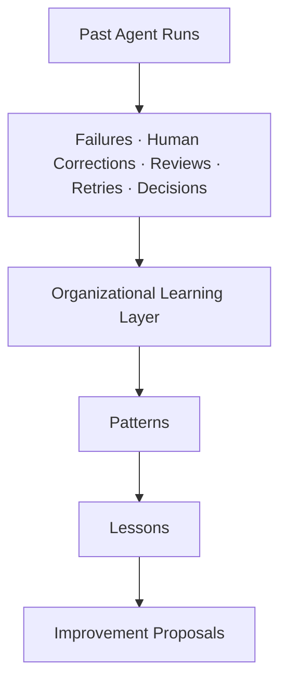
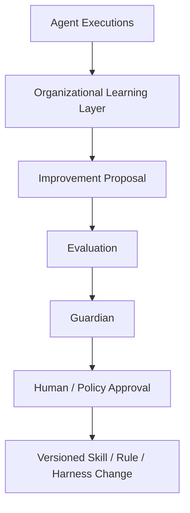

# Operating System for the Management and Orchestration of Heterogeneous Autonomous AI Agents with Organizational Memory and Controlled Self-Improvement

**Master’s Thesis Proposal**  
**Institution:** Sofia University "St. Kliment Ohridski" — Faculty of Mathematics and Informatics  
**Prepared by:** Yavor Chamov  
**Field:** Artificial intelligence, autonomous agents, multi-agent systems  
**Research area:** Agent Operating Systems  
**Status:** Initial concept for discussion with the academic supervisor  

---

## 1. Abstract

The development of large language models and autonomous AI agents is gradually shifting the focus from a single AI assistant to systems in which multiple specialized agents can perform real-world tasks, use tools, communicate with one another, and operate with a high degree of autonomy.

This proposal explores the concept of an **operating system for managing and orchestrating autonomous AI agents**—a system layer that manages heterogeneous AI agents and models from different providers as a coordinated autonomous or semi-autonomous workforce.

The goal is not to develop a new foundation model or a proprietary general-purpose AI agent. Instead, the proposal introduces a **provider-agnostic orchestration layer** that manages existing agents and provides common mechanisms for: task assignment and prioritization; dynamic agent selection based on capabilities, cost, workload, and constraints; context management and organizational memory; handoff of work between different agents; execution environments and tools; roles, permissions, policies, and autonomy levels; independent verification of results; observability, traceability, and human oversight; and extraction of organizational knowledge from past executions.

The proposed primary experimental domain is an **autonomous software engineering organization**, implemented as a small **lights-out AI factory**, in which a task can progress automatically through planning, implementation, testing, review, and evaluation.

An additional research area concerns a mechanism for analyzing previous executions, errors, human corrections, and reviews in order to extract reusable knowledge and generate proposals for improving skills, rules, workflows, and AI agent execution and management environments *(agent harnesses)*. These proposals are not applied directly; they pass through an evaluation and protective **Guardian** layer.

---

## 2. Motivation

The contemporary AI ecosystem already includes many specialized agents and models with different capabilities and limitations.

An agent may be well suited to: software development; architectural analysis; pull request reviews; testing; infrastructure analysis; research; or interaction with external tools.

The central challenge is gradually shifting from **“How do we build a better AI agent?”** to **“How do we manage multiple independent AI agents as a single reliable and coordinated system?”**

Such an environment gives rise to challenges similar to those faced by real organizations and traditional operating systems: which agent should receive a given task; how limited resources should be managed; how context should be preserved; how work should be handed off between agents; how permissions should be restricted; how errors should be detected; how work should resume after a failure; how accumulated knowledge should be retained; and how the system can improve from its own operational experience.

---

## 3. Core Research Idea

The working thesis is as follows:

> **A heterogeneous collection of AI agents can become more reliable, resilient, and progressively more efficient through an operating-system-like orchestration layer that separates organizational state from individual agents, manages tasks and resources, independently verifies results, and transforms accumulated operational experience into validated organizational knowledge.**

A key principle of the system is:

> **Agents are replaceable. Organizational knowledge must persist.**

---

## 4. Why an “Operating System”?

There is a direct analogy between a traditional operating system and an operating system for autonomous AI agents:

### Comparison of a Traditional Operating System and an AOS

| **Traditional Operating System**  | **AI Agent Operating System (AOS)**              |
|:----------------------------------|:-------------------------------------------------|
| Process                           | AI agent instance / agent execution              |
| Scheduler                         | Task and AI agent scheduler                      |
| CPU allocation                    | Model and AI agent allocation                    |
| Memory management                 | Context management                               |
| Persistent storage                | Organizational memory and artifacts              |
| Inter-process communication (IPC) | Agent-to-agent communication                     |
| System calls                      | Tool and API calls                               |
| User permissions                  | AI agent access permissions and policies         |
| Process priority                  | Task priority                                    |
| Process migration                 | Task handoff and reassignment between agents     |
| Fault tolerance                   | Automatic failover to a backup agent or provider |
| Resource accounting               | Token, latency, and financial cost tracking      |
| Kernel                            | AOS orchestration kernel                         |

---

## 5. Conceptual Architecture

---

## 6. Agent Harness: Execution and Management Environment for AI Agents

A central concept in this proposal is that **the model is not the entire system**.

An agent harness is the environment surrounding the model. It determines: how the agent receives its task; what context it can access; what tools are available to it; what permissions it has; which rules it must follow; how it communicates; when it may finish; how its result is verified; and what artifacts it must produce.

Example:

The purpose of the AOS is to manage multiple different AI agent execution and management environments through a common meta-layer for managing and coordinating agent harnesses, together with an orchestration layer.

---

## 7. Isolated Execution Environments

The following principle may be applied to execution agents:

> **Every AI agent deserves its own isolated execution environment.**

Each AI agent execution receives an isolated, ephemeral environment:

This environment can be disposable and short-lived.

The persistent state of the work is kept outside it:

> **Compute resources are replaceable. State must be durable.**

---

## 8. Artifacts, Memory, and Skills

A clear distinction is proposed among three types of organizational state:

**Artifacts.** Contain the details of a particular execution:

**Organizational Memory.** Contains important long-term information: architectural decisions; project knowledge; task history; human corrections; known problems; dependencies; and significant past decisions.

**Skills.** Represent validated, reusable organizational knowledge: repository-specific practices; code review and evaluation rules; testing strategies; deployment policies; preferred implementation approaches and patterns; and communication styles.

---

## 9. Context Management

The context window should be treated as a limited system resource.

During extended work, a session may accumulate: conversations; source code; logs; errors; tool execution results; failed execution attempts; reviews and evaluations; and decisions.

The proposed AOS includes **context compaction and summarization**:

This enables work to be handed off to another agent without transferring the entire raw history.

---

## 10. Task and Context Handoff Between AI Agents and Replaceability

One of the central research topics is **the portability of work between different AI agents**.

Example scenario:

The replacement agent must receive: the task objective; current progress; decisions already made; task-related artifacts; unresolved questions; constraints; tests and test results; earlier failed attempts and errors encountered; and reviews and evaluations.

This allows the organization to become less dependent on any particular model or provider.

---

## 11. The “Lights-Out Factory” as an Experimental Model

The proposed practical use case is an **Autonomous Software Engineering Organization**, implemented as a small lights-out AI factory.

A “lights-out factory” is a concept for a fully automated production facility that operates through artificial intelligence, automation, and robotics.

The human role shifts toward:

Example workflow:

The human defines the objective and boundaries, while the AOS manages execution.

---

## 12. Organizational Self-Improvement Layer

An additional research component is an **organizational knowledge accumulation and improvement layer**. It does not execute the primary end-user task. Instead, it analyzes previous executions:

Example: Several different agents use an inappropriate API. Human reviewers repeatedly correct them. The layer identifies the recurring pattern and proposes a new rule:

> **Repository Skill**  
> **Never** call `API X` directly.  
> **Always** use `adapter Y`.

This is a form of organizational learning that does not require retraining the underlying foundation model.

---

## 13. Guardian and Controlled Self-Improvement

The organizational self-improvement layer must not automatically modify the behavior of the system in a live production environment.

A safeguarded workflow is proposed:

The Guardian checks: security; access permissions; policy constraints; architectural constraints; regressions or degradation of existing functionality; expansion of agent capabilities and privileges; and cost impact.

Key principle:

> **Self-improvement must not lead to uncontrolled self-modification of the system.**

Every change must be: observable; measurable; version-controlled; reversible; and independently evaluated.

---

## 14. Main Research Questions

**RQ1.** What architecture is required to provide provider-agnostic orchestration of heterogeneous AI agents?

**RQ2.** Can dynamic task allocation among AI agents achieve better results than predefined static allocation?

**RQ3.** How does persistent organizational memory affect the reliability and continuity of task execution when work is handed off between different AI agents?

**RQ4.** To what extent can task execution be transferred from one AI agent to another using technology from a different provider without a significant loss of context or result quality?

**RQ5.** How does policy-governed autonomy affect the balance between efficiency, risk, and the need for human intervention?

**RQ6.** Can an AOS improve the efficiency and quality of future executions by extracting reusable organizational knowledge from earlier tasks, without changing the parameters of the underlying AI foundation models?

**RQ7.** To what extent can improvements to an AI agent’s harness, skills, and supplied context increase execution efficiency and quality while keeping the underlying foundation model unchanged?

**RQ8.** How much information necessary for task execution can be preserved when a long history of an AI agent’s work is transformed into structured context for handoff to another agent?

---

## 15. Working Hypotheses

**H1.** Dynamic allocation of tasks among AI agents will provide a better balance of quality, cost, and execution time than a predefined static workflow.

**H2.** Persistent organizational memory will increase the success rate of resuming tasks after an AI agent is replaced.

**H3.** Using structured context for handoffs between AI agents will be more efficient than providing the full history of the preceding agent session.

**H4.** Independent deterministic checks will detect errors that an AI agent fails to identify when assessing its own output.

**H5.** Using validated skills extracted from previous experience through the organizational self-improvement layer will reduce the frequency of recurring errors in subsequent similar tasks.

**H6.** Improving agent harnesses and operating rules based on analysis of previous executions will increase the task completion success rate without changing or fine-tuning the underlying language model.

---
