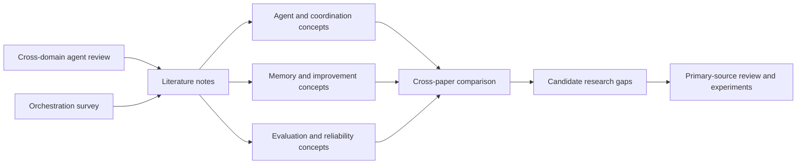

# Research Map

The following navigation is an **analyst organization of the knowledge base**, not a causal model or measured graph.

# Literature to Concepts

| Literature | Principal connections |
| --- | --- |
| [[Alaanzy-2026-Autonomous-Agents-Review]] | [[Autonomous-AI-Agents]], [[Multi-Agent-Systems]], [[Agent-Memory]], [[Agent-Coordination]], [[Agent-Evaluation]] |
| [[Zhu-2026-Multi-Agent-Orchestration]] | [[Agent-Orchestration]], [[Agent-Communication]], [[Agent-Interoperability]], [[Shared-Memory]], [[Controlled-Self-Improvement]], [[Reliability-and-Fault-Tolerance]] |

Both contribute to the provisional [[Organizational-Memory]] definition; neither alone establishes its governance requirements or experimental benefits.

# Concepts to Research Questions

| Concept cluster | Comparison question | Candidate gap |
| --- | --- | --- |
| Orchestration and interoperability | Which task semantics survive a runtime boundary? | [[Research-Gaps#G1 — Cross-Framework Orchestration Semantics]] |
| Memory and organizational knowledge | What survives agent/session replacement and remains trustworthy? | [[Research-Gaps#G2 — Persistent Organizational Memory]] |
| Communication and shared memory | Can different agents interpret and revise the same artifact consistently? | [[Research-Gaps#G3 — Knowledge Sharing Between Heterogeneous Agents]] |
| Controlled improvement | How are beneficial changes admitted without unacceptable regressions? | [[Research-Gaps#G4 — Controlled Evolution of Agent Capabilities]] |
| Reliability and persistence | What happens when execution stops between an effect and its acknowledgement? | [[Research-Gaps#G5 — Reliable Task Handoffs and Resumption]] |
| Evaluation and provenance | Can the measurements distinguish missing telemetry from successful behavior? | [[Research-Gaps#G6 — Validation and Auditability Across Changing Teams]] |

The evidence and proposed experiments for each question are in [[Research-Gaps]]. Read [[Multi-Agent-Research-Comparison]] for differences in source scope and [[Evidence-and-Uncertainties]] for unresolved issues.

# Return and Maintenance

[[Home]] · [[Research-Workflow]] · [[Processing-Report-2026-11-12]]
